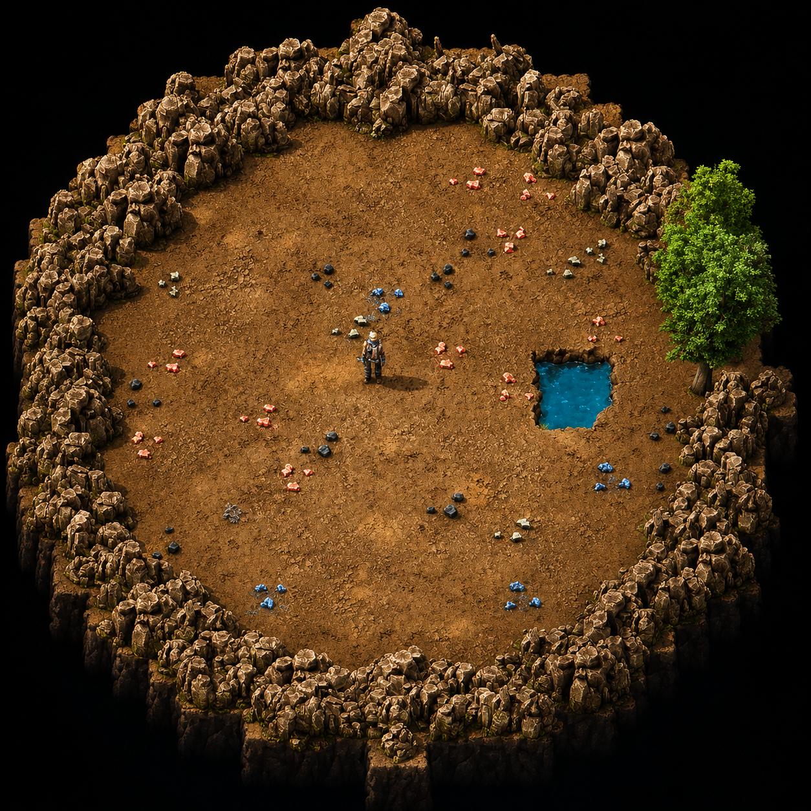

# The Cave 3.3.3

A limited patch of the supplied main-edition The Cave 3.3.2 for Factorio 2.1.23+
within the 2.1 series. Install the same 3.3.3 release on the server and clients.

This release fixes stale Collapse support caches after force merging, partial
Cave Store Box stack metadata, and truncated Uranium/Mineral information panels.
It retains the existing gameplay rules, timers, settings, prototypes and assets.
See `TESTING-3.3.3.txt` for the exact changed files, current tests and limits.
Older testing documents below describe their original releases.

## Historical 3.3.1 notes

## Factorio 2.1 update

Version 3.3.1 updates the supplied 3.2.48 release for Factorio 2.1.23 or later
in the 2.1 series. Space Age and Quality remain optional. Native headless tests
and their limits are recorded in `TESTING-3.3.0.txt`.

Version 3.3.1 gives the repaired 3.3.0 package a new release number so Factorio
recognizes the update. It retains all accumulator charging, item-transfer, item
metadata and exterior power connection fixes, plus the earlier Ctrl+Enter and
Fortified / Train Battery panel fixes. Install the same 3.3.1 release on the
server and clients.

Only release metadata and documentation changed from the repaired 3.3.0 ZIP.
All runtime files are byte-identical. The included `TESTING-3.3.0.txt` is the
historical report for that repaired build; its version references describe
that earlier package. For 3.3.1, archive integrity and version consistency were
checked; native headless tests were not repeated for this metadata-only bump.

If an existing custom keybinding remains unset, assign Ctrl+Enter again under
Settings → Controls. A graphical-client keypress test is still required.

## Earlier feature: offline-player bodies (2.6.1)

**The Cave 2.6.1** is a multiplayer/server test build based directly on the stable 2.6.0 release. It adds recoverable offline-player bodies without changing cave generation, combat balance, Vault rewards or the economy.

Release highlights:

- After a multiplayer player disconnects, a five-minute recovery timer begins.
- Rejoining before the timer ends cancels the transfer completely.
- Remaining offline moves the player's original occupied inventory stacks into a permanent lootable body at the force spawn point on the main Cave surface.
- Main inventory, armor and its equipment grid, guns, ammunition, trash slots and cursor stack are covered.
- Original item-stack data is preserved with slot-to-slot swaps rather than name/count recreation.
- The feature is controlled by **Mod Settings → Startup → Offline Player Body → Enable / Disable** and is enabled by default.
- Version 2.6.0 gameplay, Fortified Vault rewards and balance remain unchanged.

<p align="center"></p>


## Overview

> A relaxed underground exploration and survival scenario for Factorio 2.1 / Space Age.

The Cave is a large underground adventure inspired by Diggy and rebuilt around exploration, digging, treasure, enemies, progression, market rewards and portable train interiors.

Dig through solid rock, discover caverns, uncover ore veins, find loot, fight underground threats, and build a mobile train-base that can travel with you through the cave.

---

## Underground Exploration

The world is covered in mineable cave walls. As you dig, the cave opens up and reveals new rooms, resources, enemies and rewards.

The underground difficulty scales by depth:

- Easy
- Medium
- Hard
- Nightmare

Deeper areas are more dangerous, but the rewards become stronger too.

---

## Cavern System

Caverns are designed around clear room identities so exploration feels readable and rewarding.

- Empty Rooms
- Sanctuary Rooms
- Hoard Rooms
- Nest Rooms
- Resource Caverns
- Nuclear Caverns
- Boss Caverns
- Infested Caverns
- Fortified Research Vaults
- Secret reward areas

Enemy pressure scales by cave zone, while fixed economic rewards stay controlled to avoid runaway farming.

### Hoard Room

Hoard Rooms retain their original 8-9 Steel Chests, basic random supplies, mobile defender budgets and normal room shapes. Their static defence is now fixed by zone: Easy has 2 Gun Turrets, 1 Laser Turret and 1 Worm; Medium has 3/2/2; Hard has 4/3/3; Nightmare has 6/4/4.

Every room also distributes guaranteed progression bundles across all of its chests. Modules advance from level 1 in Easy to level 3 in Nightmare; belts, underground belts, splitters and inserters expand gradually by zone; processed uranium and fresh fuel cells begin in Medium; and Laser/Flamethrower Turrets are awarded as a small combined random total. Space Age quality modules, turbo belts, stack inserters and planetary science packs are included only when their prototypes exist. Science Pack rewards are checked against the discovering Force's current recipe/technology unlocks when the room is generated, range from 20-30 of each unlocked pack in Easy to 80-100 in Nightmare, and never exceed 100 per pack.

Administrators can use `/the-cave-hoard-test easy`, `medium`, `hard` or `nightmare` to open a production-table test room nearby without changing natural discovery pacing.

### Fortified Research Vault

A rare adventure encounter available from Medium depth onward. Six reward caches sit in the centre of a large fortified room while randomized turret positions prevent players from memorizing a single safe attack angle. Hard and Nightmare add carefully tiered Behemoth defenders and stronger randomized rewards. Vault generation includes both a room cooldown and a 256-tile spacing rule so exploration does not become continuous combat.

---

## Train Interiors

The Cave includes integrated Train Interiors when the setting is enabled.

Players receive a starter train and can enter the train using **Ctrl + Enter**. The train interior acts like a portable base with connected rooms for locomotives, cargo wagons and fluid wagons.

Train Interior features include:

- Persistent player-built interiors
- Connected wagon rooms
- Cargo wagon import/export chest ports
- Fluid wagon import/export tank ports
- Interior utility lanes for pipes and power
- Working map view inside train interiors
- Clean void outside the train rooms
- Outside camera view while inside the train
- Starter locomotive, cargo wagon and fluid wagon
- A 30-second multiplayer Game Over countdown if the final Main Train locomotive is destroyed, or if every registered Main Train part is lost

Cargo and fluid ports show simple role labels when selected:

- Only Import
- Only Export

---

## Train Battery System

Version 2.2 adds the finished Train Battery progression system.

The starter train begins with **no installed train battery**. Power export is disabled until the player researches Train Battery Upgrade 1.

Before the battery is researched, selecting the locomotive shows:

```text
Train Battery
Not Installed
Research Train Battery Upgrade 1
Power Export: Disabled
```

After research, selecting the locomotive shows a clear multi-line battery status:

```text
Train Battery Level 1
Charge: 400 / 6000 MJ
Charge: 7%
Charging Mode: Charging
```

The train battery is capacity-based. It does not use a small fixed MW output cap. Outside machines drain the stored MJ amount naturally:

- Higher outside power usage drains the battery faster.
- Lower outside power usage drains the battery slower.
- Interior train power generation charges the battery.
- Charging starts again at 25% and stops at 100%.
- Charging speed scales by Train Battery level, so higher levels can use stronger interior power production instead of staying stuck at the old low charge rate.
- Outside power hookup only works near the locomotive, about 6 tiles away.

Train Battery capacities:

| Upgrade | Capacity |
|---|---:|
| Level 1 | 6000 MJ |
| Level 2 | 8000 MJ |
| Level 3 | 12000 MJ |
| Level 4 | 16000 MJ |
| Level 5 | 20000 MJ |
| Level 6 | 25000 MJ |

Research costs:

| Upgrade | Science cost | Time |
|---|---|---:|
| Level 1 | 300 Red | 15s |
| Level 2 | 500 Red + Green | 15s |
| Level 3 | 800 Red + Green | 15s |
| Level 4 | 1000 Red + Green + Blue | 15s |
| Level 5 | 1200 Red + Green + Blue + Purple | 15s |
| Level 6 | 1500 Red + Green + Blue + Purple + Yellow | 15s |

---

## Coin Economy and Market

Enemies drop Coins when defeated. Coins are physical items that can be picked up, stored, shared and spent.

The Cave includes a market progression system with useful rewards, power upgrades, logistics items, military items and late-game tools.

Enemy coin income is balanced around nest ownership and anti-farming rules so combat stays rewarding without becoming an infinite exploit.

---

## Train Shield System

Train Shield upgrades reinforce every Cave train part individually.

While Train Interiors is enabled, newly generated Nauvis cave chunks guarantee another abandoned Locomotive, Cargo Wagon, Fluid Wagon or Artillery Wagon whenever exploration reaches at least 200 tiles from every previous find. Finds have no Easy, Medium, Hard, Nightmare or global quantity cap; the Main Train itself still accepts at most ten registered parts.

Base rolling stock health starts at **5,000 HP**. The 10-level research chain adds **+3,000 HP per level**, reaching **35,000 HP** at Level 10.

Each level also improves automatic self-repair by **+5 HP/sec**, reaching **50 HP/sec** at Level 10. Repair packs do not quickly repair Cave train rolling stock; damaged locomotives and wagons recover slowly through the Train Shield system instead.

The upgrade applies to every supported rolling stock entity: locomotive, cargo wagon, fluid wagon, artillery wagon, and found/merged train parts.

The research chain is shared between base Factorio and Space Age. It uses normal science packs up to Space Science and does not require Space Age-only science packs.

Train Interior sync is designed to keep all physically connected rolling stock on one shared interior surface. Ctrl+Enter from any wagon/locomotive enters the same connected-train interior, and the entry point is a small 3x3 pad above the top Hazard Concrete/utility lane so players are not dropped into machines or pipes.

Registered Main Train stock, Train Interior-linked wagons and unclaimed abandoned train parts ignore damage caused directly by a Demolisher or its segments/attacks. Every other damage source still uses the normal Train Shield rules, and unrelated ordinary trains remain vulnerable.

## Inserter Configuration

The Cave includes integrated research-gated Inserter Configuration controls.

- The Startup setting uses an explicit **Enable / Disable** dropdown.
- It is enabled by default.
- Inserters keep their original vanilla pickup and drop positions.
- Research level 1 unlocks precise drop-offset selection; later levels progressively unlock extended straight, diagonal and off-axis positions.
- Bob's Adjustable Inserters (`bobinserters`), Inserter Config (`Inserter_Config`), and Side Inserters can load alongside The Cave.
- These inserter-control systems must not be enabled at the same time as The Cave's integrated system. When using any of them, set The Cave's **Inserter Configurable** Startup setting to **Disable** before loading the save.

## Turret Range Upgrade

The Turret Range research chain upgrades supported turrets while keeping their normal inventory items, blueprints, ghosts, and Smart Pipette behavior.

Pressing **Q** on a researched turret correctly selects the original turret item, including Gun, Laser, Flamethrower, Rocket, Tesla, and Railgun turret variants when those prototypes are available.

## Darkness Infestation

Darkness Infestation is a player-centred challenge system and is **enabled by default**.

- The 5x5 chunks centred on the force spawn are safe.
- Outside that area, a powered vanilla Small Lamp within 12 tiles or a powered integrated Lamp Post within 30 tiles protects the player.
- Remaining unlit for 30 seconds starts spawning cave enemies near that player.
- Newly spawned enemies attack the exposed player directly.
- Remote View cannot redirect Darkness checks or enemy spawning to a different surface.
- Entering a vehicle temporarily resets the darkness threat.
- The system does not alter the lamp, its light size, recipe, power use, electrical network, or circuit behavior.

Enable it from:

```text
Mod Settings → Startup → Darkness Infestation → Enable
```


## Offline Player Body

The multiplayer recovery system is enabled by default. When a player disconnects, The Cave waits exactly five minutes of server game time. If that player reconnects before the deadline, the pending recovery is cancelled and their inventory is untouched.

If the player remains offline, every occupied personal item stack is moved into a permanent character corpse at the normal spawn point of that player's force on the main Cave surface. The body is lootable by the team and does not expire. Players who logged out far away, inside a Uranium Cave, Fortified Vault or Train Interior therefore do not force the team to travel back to the logout position.

The transfer covers the main inventory, armor and its equipment grid, guns, ammunition, trash slots and cursor stack. The implementation moves the original stacks directly so quality, durability, ammunition state, blueprints, tags and equipment grids are retained.

Enable or disable it from:

```text
Mod Settings → Startup → Offline Player Body → Enable / Disable
```

## Optional Challenge Systems

The Cave includes several optional systems and startup settings:

### Cave Collapses

Choose whether the system is active before loading the save:

- **Disable** (default): no cave-ins, collapse warnings, alarms or sounds; Support Struts research is hidden.
- **Enable**: the original fast and destructive collapse balance, with only the real boxed countdown shown before a scheduled failure.

When enabled, every player receives 2,000 Stone Walls, but the starter chamber does not place any support walls automatically. Ten Support Struts technologies extend wall and reactor support reach from 4 to 14 tiles. The chain begins with Automation science, ends with Utility science and does not require Space science.

### Ore Patch Missing

Optional challenge mode, disabled by default. One basic natural ore patch type can be missing from the map, forcing the player to rely more heavily on digging yields.

### Ore Blood

Enabled by default. Biters and spitters can drop basic resources such as iron ore, copper ore, coal or stone. Drops use walk-over pickup like Coins.

### Wind Turbine

Enabled by default. Its Startup option controls the item, recipe and three-stage research chain. Disabling it hides the feature and sets already placed turbines to zero output without deleting them; re-enabling restores their output from completed Force research.

### Uranium Caves

Enabled by default. From Medium depth onward, Uranium Cave entrance rooms use weight 12, remain at least 300 tiles apart and use a per-Force anti-drought guarantee after twelve eligible opened rooms without Uranium. Uranium always resolves before Mineral Cave conversion. The final entrance creator independently enforces the same 300-tile exclusion radius, including administrator-created test entrances.

Use `/the-cave-uranium-spacing-test` as an administrator on the upper Cave surface to audit every registered Uranium entrance and print the closest measured pair as PASS or FAIL.

### Iron, Copper and Coal Mineral Caves

Iron Cave, Copper Cave and Coal Cave each have an independent Startup option and all three default to Enabled. From Medium depth onward, 20% of eligible ordinary empty cavern rooms in Nauvis, Fulgora, Gleba, Vulcanus and Aquilo regions can become a timed Mineral Cave entrance without reducing Uranium Cave or special-room priority. After five successfully opened empty-room misses, the next location that can accept at least one enabled resource type is guaranteed to become a Mineral Cave. Failed or overlapping attempts do not consume this per-Force, per-surface counter.

The 192-tile exclusion applies only to the same resource: Iron-to-Iron, Copper-to-Copper and Coal-to-Coal. Different Mineral resources and Uranium may appear beside one another. Each Mineral entrance contains exactly one resource from a deterministic per-Force cycle of five Iron, three Copper and two Coal caves. A disabled resource is removed from new cycles while the relative weights of the remaining resources are preserved. When the next deck entry is blocked by a nearby cave of the same type, selection looks ahead for a legal different type without changing the cycle totals; the chosen entry is consumed only after its entrance is created successfully.

### Underground Village (Lost City)

Disabled by default. When its independent Startup option is enabled, 10% of remaining eligible ordinary empty rooms from Medium depth onward can reveal an Underground Village entrance. After ten eligible misses, the next legal room is guaranteed. Village entrances reserve 400 tiles from other Village entrances even after sealing; a blocked candidate preserves the guarantee until an entrance is actually created. Disabling the option later prevents new Villages without deleting existing entrances or active operations.

The first entrant starts one shared 30-minute Force timer. Later entrants receive only the remaining time, leaving never pauses or resets it, and every player still below at 00:00 dies before the passage seals. The upper big pole is linked directly to the lower grid and entry lamp. Lost City is a forced Darkness Zone: only a powered Small Lamp or Lamp Post resets the 30-second attack grace period.

The Lost City remains unbounded and grows only as players explore. Its 8x8, 16x16 and 32x32 abandoned-settlement layouts are scattered at jittered positions across untouched natural terrain, with broad dense and sparse districts, water exclusions and empty wilderness pockets. There is no repeated paved chunk grid. Its map generator uses a strict Nauvis-only whitelist for terrain, water, trees, rocks, resources, decoratives and enemies; Gleba, Vulcanus, Fulgora and Aquilo content cannot autoplace there even when Space Age or Everything on Nauvis is enabled. Expedition buildings belong to the discovering Force and can be mined or robot-deconstructed; deliberate biter nests remain hostile.

Each operation creates a separate unbounded city surface. Only explored chunks generate, with recurring streets, mineable abandoned buildings, compact loot and bounded mining ambushes. The handcrafted central district retains the NPC mission chain and reward crate.

The first successful entry creates the fixed Blue Belt item transfer and direct power link, then starts one shared 30-minute timer. Dormant entrances remain visually compact and never need fluid pipes. The cave is dry and pitch black. Up to ten large rooms generate naturally; manual tunnels and extremely rich single-resource veins continue without a distance cap. ENTER and EXIT remain usable until 00:00, when the cave seals permanently and anyone or anything left below is lost.

On Vulcanus, cover destroyed directly by a moving Demolisher now preserves its deterministic resource result instead of erasing it. Demolisher digs also retain eligible Uranium, Iron, Copper and Coal extraction opportunities, but never open ordinary, enemy, hoard, treasure, fortress or planetary progression rooms. A selected entrance is placed in a dry side chamber away from the body path; unsafe placement consumes neither the Mineral deck entry nor the extraction guarantee. A local collision-width-aware frontier envelope follows nearby Demolishers, preventing body segments from disappearing into `out-of-map` without moving, cloning or replacing the unit.

### Underground Lighting Mode

Choose how dark the cave should be:

- Normal
- Permanent Day
- Permanent Night
- Pitch Black

### Everything On Nauvis

Keeps Space Age-style content folded into Nauvis cave progression by default. The four official Planet Discovery technologies are completed for every playable force, while the remaining planetary technologies still require their normal regional resources, triggers and science packs.

Space Science becomes a 100-unit laboratory research using Metallurgic, Agricultural, Chemical and Electromagnetic Science Packs. Its official 2 Iron Plate + 1 Carbon + 1 Ice recipe can then be crafted on the shared cave surface. Rocket Silos, Space Platforms, planets and interplanetary travel remain available but are no longer mandatory for the first Space Science.

When Everything On Nauvis is disabled, official Space Age discovery, Space Science and interplanetary progression remain unchanged.

---

## Quality of Life

- Backspace or the Behemoth Biter shortcut-bar button clears nearby temporary enemy corpses.
- Ctrl+R reloads friendly Gun Turrets in the nearby 20x20 area when no Inserter is selected; the Gun Turret shortcut-bar button always runs reload directly.
- ALT mode shows the loaded magazine count above nearby friendly ammo turrets, including a red 0 for empty turrets and every researched Gun Turret range variant.
- Optional mining drill resource filters.
- Configurable raw ore stack sizes.
- Integrated FuelGlow colours for burner entities and reactors, with optional electric-furnace lighting.
- Integrated research-gated waypoint teleporter opened from the shortcut bar or with Ctrl+T, with camera/minimap previews, 2→3→4 preserved destination slots, fixed circuit costs and a shared two-minute cooldown.
- Optional Space Age belt-stacking path.
- Optional integrations for supported companion mods.

---


### Multiplayer Train Safety Lock

In multiplayer, locomotives are protected from accidental or malicious driving. Admin players may always drive the train. Non-admin players must pass a majority vote before they can pilot the train, helping protect the portable train base from griefing or being driven into danger.

## Credits

Original mod: **Diggy**  
Original author: **bits-orio**

Fork, rebuild, balancing and maintenance:  
**behroozzx**

Additional integrated systems include credited third-party components where required by their licenses. See the included license files.

The integrated waypoint Teleporter is adapted from **Khalc Teleport** by **Khalcifer** under the MIT License.

Integrated Arachnid enemies are adapted from **Arachnids_enemy** by **MFerrari**, with upstream credits to **Aotenshin**, **MnHebi** and **Sobigdrasil**, under the MIT License.

---

## License

This fork keeps the original license terms from Diggy. See the included `LICENSE` file.


## Underground Belt Reach

Optional seven-level research increases the real placement distance of official underground belts while keeping the native Level 0 ranges: yellow 4, red 6, blue 8, and Turbo 10. From Level 1 onward, the normal belt item is converted only while held in the player's cursor to a hidden, visually identical item/entity variant with the researched `max_distance`. Mining, smart pipette, blueprints, ghosts, and construction robots still use the original official belt item. This keeps the native green guide and the real connection distance identical.
